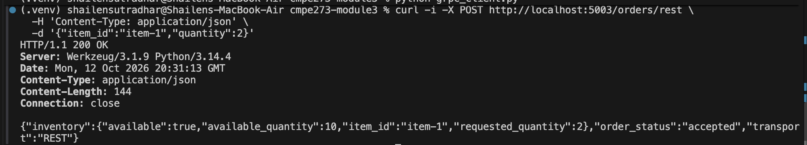
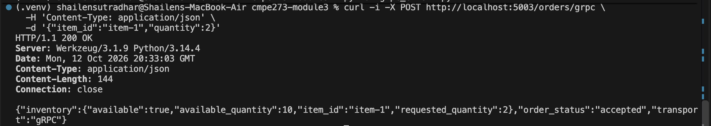
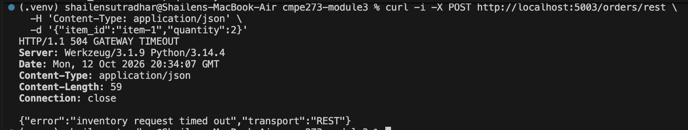
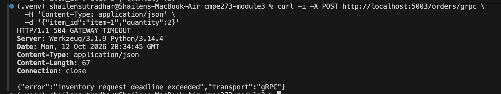
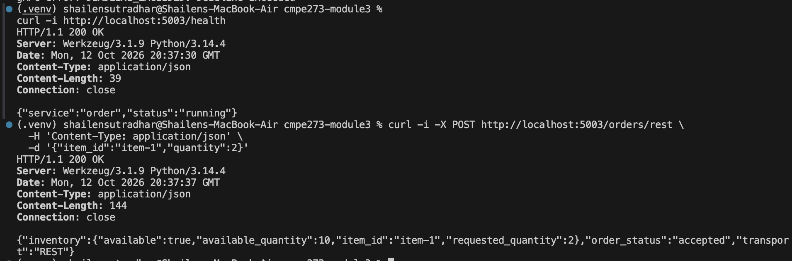
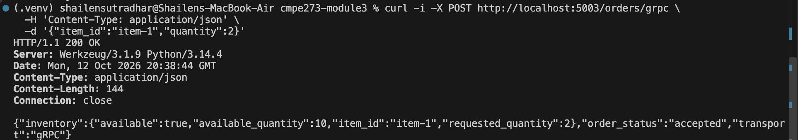

# Module 3: REST and gRPC Service Contracts

This project implements the same Order → Inventory interaction using REST/HTTP and gRPC.

The Inventory Service exposes both interfaces:

- REST: `POST http://localhost:5001/inventory/check`
- gRPC: `localhost:5002`, contract in [`proto/inventory.proto`](proto/inventory.proto)

The Order Service exposes two test endpoints:

- `POST http://localhost:5003/orders/rest` calls Inventory over REST.
- `POST http://localhost:5003/orders/grpc` calls Inventory over gRPC.

Both calls use a one-second timeout/deadline. The Inventory Service supports a temporary delay through `INVENTORY_DELAY` so timeout behavior can be reproduced.

## Setup

```bash
python3 -m venv .venv
source .venv/bin/activate
pip install -r requirements.txt
```

The protobuf modules are included in the repository. To regenerate them after editing the contract:

```bash
python -m grpc_tools.protoc -I proto --python_out=. --grpc_python_out=. proto/inventory.proto
```

## Run the services

Terminal 1 — start the Inventory Service:

```bash
source .venv/bin/activate
python inventory_service.py
```

Terminal 2 — start the Order Service:

```bash
source .venv/bin/activate
python order_service.py
```

The Order Service listens on port 5003. The Inventory Service listens on REST port 5001 and gRPC port 5002.

## Successful REST request

```bash
curl -i -X POST http://localhost:5003/orders/rest \
  -H 'Content-Type: application/json' \
  -d '{"item_id":"item-1","quantity":2}'
```

Expected response:

```text
HTTP/1.1 200 OK
...
{"inventory":{"available":true,"available_quantity":10,"item_id":"item-1","requested_quantity":2},"order_status":"accepted","transport":"REST"}
```

Captured evidence:



## Successful gRPC request

The following direct client proves that the gRPC `.proto` contract works:

```bash
python grpc_client.py
```

Expected output:

```text
gRPC response:
{'available': True, 'item_id': 'item-1', 'requested_quantity': 2, 'available_quantity': 10}
```

Captured direct gRPC evidence:


The following request proves that the Order Service invokes Inventory through gRPC:

```bash
curl -i -X POST http://localhost:5003/orders/grpc \
  -H 'Content-Type: application/json' \
  -d '{"item_id":"item-1","quantity":2}'
```

Expected response:

```text
HTTP/1.1 200 OK
...
{"inventory":{"available":true,"available_quantity":10,"item_id":"item-1","requested_quantity":2},"order_status":"accepted","transport":"gRPC"}
```

Captured Order → Inventory gRPC evidence:



## Timeout and deadline evidence

Stop the Inventory Service and restart it with a three-second delay:

```bash
INVENTORY_DELAY=3 python inventory_service.py
```

The REST request takes longer than the Order Service's one-second HTTP timeout:

```bash
curl -i -X POST http://localhost:5003/orders/rest \
  -H 'Content-Type: application/json' \
  -d '{"item_id":"item-1","quantity":2}'
```

Expected result:

```text
HTTP/1.1 504 Gateway Timeout
{"error":"inventory request timed out","transport":"REST"}
```

Captured REST timeout evidence:



The gRPC request takes longer than the one-second deadline:

```bash
curl -i -X POST http://localhost:5003/orders/grpc \
  -H 'Content-Type: application/json' \
  -d '{"item_id":"item-1","quantity":2}'
```

Expected result:

```text
HTTP/1.1 504 Gateway Timeout
{"error":"inventory request deadline exceeded","transport":"gRPC"}
```

Captured Order Service gRPC deadline evidence:



For direct gRPC deadline evidence, run:

```bash
INVENTORY_DELAY=3 python grpc_client.py
```

Expected result:

```text
gRPC error: DEADLINE_EXCEEDED: Deadline Exceeded
```

Captured direct gRPC deadline evidence:


## Evidence that the Order Service remains running

After both timeout tests, leave the Order Service running and disable the delay by restarting the Inventory Service normally:

```bash
python inventory_service.py
curl -i http://localhost:5003/health
curl -i -X POST http://localhost:5003/orders/rest \
  -H 'Content-Type: application/json' \
  -d '{"item_id":"item-1","quantity":2}'
```

Expected evidence:

```text
HTTP/1.1 200 OK
{"service":"order","status":"running"}

HTTP/1.1 200 OK
{"inventory":{"available":true,"available_quantity":10,"item_id":"item-1","requested_quantity":2},"order_status":"accepted","transport":"REST"}
```

The same follow-up can be sent to `/orders/grpc`; the response should be successful with `"transport":"gRPC"`. The timeout handlers return an error response but do not terminate the Flask Order Service process.

Captured evidence that the Order Service remained running after the failures:





## Additional status behavior

An unknown item returns `404 Not Found` over REST and maps from gRPC `NOT_FOUND`. A known item with insufficient quantity returns `409 Conflict` over REST and maps from gRPC `FAILED_PRECONDITION`.

## REST versus gRPC comparison

REST was simpler to inspect manually because requests and responses are readable JSON sent with ordinary HTTP tools such as `curl`. gRPC required a `.proto` contract and generated Python modules, but it provided strongly typed request and response messages. REST communicates failures through HTTP status codes, while gRPC uses explicit statuses such as `NOT_FOUND`, `FAILED_PRECONDITION`, and `DEADLINE_EXCEEDED`. Both supported clean timeout handling, but the gRPC deadline was part of the RPC call itself. Overall, REST had less setup overhead, while gRPC provided a stricter service contract and better built-in RPC semantics.
